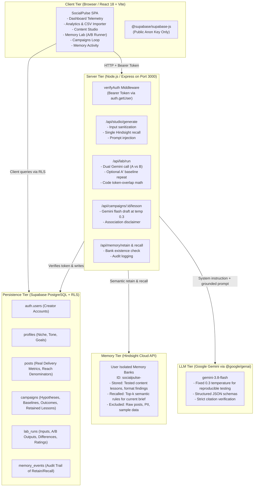

# SocialPulse AI

> **Grounded Instagram Creator Intelligence with Per-User Persistent Memory (Hindsight) & Controlled A/B Evaluation (Gemini 3.8 Flash).**

---

## 1. Project Overview

SocialPulse AI is an agentic content intelligence workspace for Instagram creators and growth teams. Instead of treating large language models as disposable chat sessions that restart from zero every day, SocialPulse pairs **Gemini 3.8 Flash** with **Hindsight Agent Memory Cloud** and **Supabase (PostgreSQL with Row Level Security)** to build a cumulative, self-improving memory bank for every creator.

### The Problem
Most AI content tools provide generic advice ("Use a catchy hook", "Post consistently"). They suffer from **amnesia**:
- They don't know which of your posts actually drove bookmark saves or virality last week.
- They repeat patterns that failed previously.
- They lack a feedback loop connecting post performance back to ideation.

### The Solution
1. **Empirical Grounding:** Ingest real post delivery from Meta Business Suite (reach, impressions, saves, likes). Zero fake zero substitutions.
2. **Close the Loop:** Formulate testable campaign hypotheses, evaluate actual post outcomes against format baselines in code, and retain validated empirical lessons.
3. **Per-User Memory Isolation:** Retain and recall lessons strictly in user-isolated Hindsight memory banks (`socialpulse-<user-id>`).
4. **Fair A/B Lab Evaluation:** Side-by-side reproducible testing in **Memory Lab** (Without Memory vs. With Recalled Memory) holding model, prompt template, and low temperature (0.3) constant.

---

## 2. Architecture & Data Flow



### Data Storage Boundaries
- **Supabase PostgreSQL:** Stores user profiles, imported post metrics, campaigns, lab runs, and audit logs. Protected by strict Row Level Security (`auth.uid() = user_id`) on every table.
- **Hindsight Cloud:** Stores verified creator lessons, empirical takeaways, and contextual tags in isolated banks (`socialpulse-<user-id>`). Raw post tables and sample datasets are **never** written to Hindsight.
- **Client Bundle:** Holds only public environment variables (`VITE_SUPABASE_URL`, `VITE_SUPABASE_ANON_KEY`). Service role keys, `GEMINI_API_KEY`, and `HINDSIGHT_API_KEY` are kept exclusively on the server.

---

## 3. Tech Stack

- **Frontend:** React 18, Vite, TypeScript, Tailwind CSS, Lucide React, Recharts
- **Backend Server:** Node.js, Express, tsx
- **Database & Auth:** Supabase (PostgreSQL 15+, Row Level Security, Supabase Auth)
- **AI & Synthesis:** `@google/genai` (Gemini 3.8 Flash)
- **Agent Memory:** Hindsight API (Vectorize.io) with per-user bank partitioning
- **Testing:** Node.js native test runner (`node:test`, `node:assert/strict`)

---

## 4. Step-by-Step Setup Guide

### 1. Supabase Project Setup
1. Log in to [Supabase](https://supabase.com) and create a new project on the free tier.
2. In **Project Settings > API**, copy the **Project URL** and the **anon public key**.
3. In **Authentication > Providers > Email**:
   - For fast local or hackathon testing, turn OFF **"Confirm email"**. (Remember to turn it back on before serving production users).
4. Run the database migrations in the **SQL Editor** in sequential order:
   - Run `supabase/migrations/001_init.sql` (Creates `profiles`, `posts`, `content_ideas`, `campaigns`, `memory_events`, RLS policies, indexes).
   - Run `supabase/migrations/002_lab_runs.sql` (Creates `lab_runs` with RLS).
   - Run `supabase/migrations/003_campaign_loop.sql` (Alters `campaigns` to add close-the-loop columns and foreign keys).

### 2. Environment Variables & Secrets Configuration
In AI Studio Secrets (or your `.env` file for local development), provide:

```bash
# Gemini AI
GEMINI_API_KEY="your-gemini-api-key"
GEMINI_MODEL="gemini-3.8-flash"

# Hindsight Agent Memory
HINDSIGHT_API_KEY="your-hindsight-api-key"
HINDSIGHT_BASE_URL="https://api.hindsight.vectorize.io/v1"
HINDSIGHT_BANK_ID="socialpulse-default"

# Supabase (Public anon key only - NEVER use service_role)
VITE_SUPABASE_URL="https://your-project-ref.supabase.co"
SUPABASE_URL="https://your-project-ref.supabase.co"
VITE_SUPABASE_ANON_KEY="your-public-anon-key"
SUPABASE_ANON_KEY="your-public-anon-key"
```

### 3. Running Locally
```bash
# Install dependencies
npm install

# Start the full-stack development server (Express backend + Vite middlewares)
npm run dev

# App runs on port 3000
http://localhost:3000
```

---

## 5. How Hindsight Is Used

- **Per-User Memory Banks:** Bank IDs are deterministically derived via `getUserBankId(userId) = "socialpulse-" + userId.toLowerCase().replace(/[^a-z0-9_-]/g, "-")`. User A cannot see, query, or overwrite User B's memories.
- **What is Stored:** Verified creator takeaways, tested format findings, and hypothesis outcomes with explicit statistical sample sizes ($n$).
- **What is NOT Stored:**
  - Raw post records or user account tokens.
  - Simulated sample data (`isSample === true` is strictly barred from retention).
  - Unverified or unapproved ideas.
- **Transparent Audit Logging:** Every retain and recall operation is recorded in `memory_events` in PostgreSQL, logging timestamp, latency, status (`success` / `failed`), and scope.

---

## 6. How the Memory Lab Comparison Is Made Fair

Memory Lab is engineered to eliminate confounding variables:
1. **Shared Prompt Template:** Both Test A and Test B use the exact same system instructions, input brief, output JSON schema, and creator profile.
2. **Fixed Low Temperature:** Explicitly pinned to `0.3` to suppress stochastic variation while allowing deterministic instruction following.
3. **Identical Model:** Both runs execute against `gemini-3.8-flash`.
4. **Isolated Independent Variable:** The **only** difference between Test A and Test B is the injected Hindsight memory block.
5. **Baseline Repeat (A'):** When selected, Test A is executed twice to quantify the model's natural output variation without memory grounding.
6. **Code-Calculated Metrics:** Difference statistics (token overlap Jaccard similarity, hook shifts, memory citations) are computed directly by TypeScript code, not by subjective AI evaluation.

---

## 7. Verification & Testing

Run the automated test suite using the native Node.js test runner:

```bash
# Run all unit tests
npx tsx --test src/lib/*.test.ts

# Run specific campaign engine tests
npx tsx --test src/lib/campaignEngine.test.ts

# Validate TypeScript & Linting
npm run lint

# Compile production build
npm run build
```

---

## 8. Known Limitations

- **CSV Ingestion Only:** Post delivery is imported via CSV export from Meta Business Suite (no direct Instagram Graph API OAuth integration in this build).
- **No Direct Publishing:** The app acts as an intelligence and ideation copilot; it does not directly publish to Instagram.
- **Association, Not Proven Cause:** Observational post delivery metrics cannot control for algorithmic distribution factors. The application explicitly labels all findings as observed associations rather than proven causal relationships.
- **Sample Data Flag:** Simulated demo data is permanently watermarked with `[SAMPLE DATA]` chips and is excluded from database writes and Hindsight retention.
